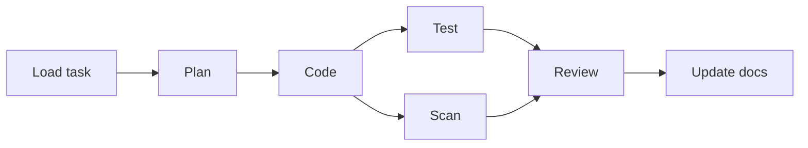

# Onur's Orchestration

[](https://github.com/onurergut/Onurs_Orchestration/actions/workflows/ci.yml)

A self-hosted Python service for running software-engineering tasks through a seven-stage agent pipeline. It is an early prototype: the stage framework and supporting adapters are implemented, while task intake, review delivery, and durable resume are not yet connected end to end.

## Pipeline



| Stage | Implementation | Output |
|---|---|---|
| Planner | CrewAI agent | Files, steps, and risks |
| Coder | CrewAI agent | Structured change summary |
| Tester | `pytest` subprocess | JUnit and coverage results |
| Security | `bandit` subprocess | Parsed findings |
| Reviewer | CrewAI agent | Structured review comments |
| Docs | CrewAI agent | Proposed documentation update |

Testing and security scanning start after coding and both finish before review. Each stage checks a monthly project budget and writes audit events. LLM stages accept OpenAI-compatible or Anthropic-compatible endpoints through `LLM_*` environment variables.

## Current status

Implemented now:

- The six processing stages above, plus task loading, joined by a CrewAI flow.
- CSV, GitHub Issues, Jira, and Linear task-source adapters.
- Web, GitHub pull request, Jira comment, and Slack review adapters.
- Worktree helpers, a TTL sweeper, circuit breaker, fallback chain, and Redis rate limiting.
- Authenticated suggestion list, detail, and selection endpoints.
- PostgreSQL, Redis, Alembic migrations, Prometheus metrics, and OpenTelemetry setup.
- GitHub Actions CI running Ruff, mypy, migrations, and pytest.

Not connected yet:

- The worker does not select a task source or review adapter, create a worktree, or invoke human review.
- Stage progress and artifacts remain in memory; completed stages are not written back for restart.
- The coder returns a structured summary. It does not yet apply repository changes.
- Selecting a suggestion can create tasks, but automatic execution is only logged.
- The SWE-bench runner is a skeleton and is not a completed benchmark result.

## Quick start

Requires Python 3.12, Docker, and an OpenAI-compatible or Anthropic-compatible LLM endpoint.

```bash
python3.12 -m venv .venv
source .venv/bin/activate
cp .env.example .env
make install
make docker-up
make migrate
```

Run the service:

```bash
make run      # API at http://127.0.0.1:8000
make worker   # requires an existing run UUID argument
make test
make lint
```

`make worker` calls the worker without a run ID, while the worker requires `python -m orchestration.workers.orchestrator_worker <run-uuid>`. Create the run row first. `make e2e-m2` is a manual live-LLM check, not part of CI.

## API

| Method | Path | Auth | Purpose |
|---|---|---|---|
| `GET` | `/health` | No | Process health |
| `GET` | `/ready` | No | PostgreSQL and Redis readiness |
| `GET` | `/metrics` | No | Prometheus metrics |
| `GET` | `/me` | API key | Authenticated user |
| `GET` | `/projects/{id}/suggestions` | API key | Pending suggestions |
| `GET` | `/projects/{id}/suggestions/{id}` | API key | Suggestion detail |
| `POST` | `/projects/{id}/suggestions/{id}/pick` | API key | Select proposals and create tasks |

Interactive API docs are available at `/docs`.

## Configuration

Copy `.env.example` and replace the placeholder LLM key. The application reads `LLM_PROTOCOL`, `LLM_ENDPOINT_URL`, `LLM_API_KEY`, and `LLM_MODEL` directly from the environment. `TASK_SOURCE_TYPE` and `REVIEW_SURFACE_TYPE` are present in settings, but the current worker does not use them to select adapters.

PostgreSQL and Redis credentials in the example match Docker Compose for local development. Change them before any shared or deployed use.

## Development

```text
src/orchestration/
├── api/            FastAPI application, health, and suggestions
├── orchestrator/   CrewAI flow and budget check
├── stages/         Planner, coder, tester, security, reviewer, docs
├── adapters/       Task-source and review-surface implementations
├── llm/            Provider clients, routing, fallback, limits
├── storage/        SQLAlchemy models, PostgreSQL, Redis
├── workers/        Single-run worker and worktree sweeper
└── observability/  Auditing, tracing, and metrics
```

The detailed design and milestone plan live in [`docs/superpowers/specs/2026-08-07-orchestration-design.md`](docs/superpowers/specs/2026-08-07-orchestration-design.md).

## License

No license is currently declared. All rights are reserved by the copyright holder.
