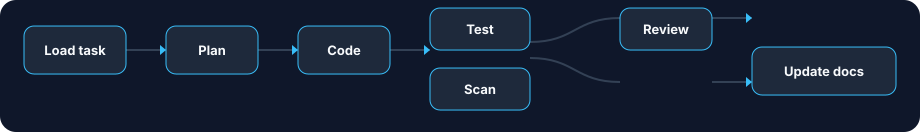

<p align="center">
  
</p>

<h1 align="center">Onur's Orchestration</h1>

<p align="center">
  A self-hosted pipeline that turns a software task into a plan, implementation summary, test report, security scan, review, and documentation update.
</p>

<p align="center">
  <a href="https://github.com/onurergut/Onurs_Orchestration/actions/workflows/ci.yml"></a>
  
  
</p>

<p align="center">
  <a href="#quick-start">Quick start</a> ·
  <a href="#how-it-works">How it works</a> ·
  <a href="#current-status">Current status</a> ·
  <a href="#api">API</a> ·
  <a href="#development">Development</a>
</p>

---

## Why it exists

Coding agents are useful, but a raw model call has no repeatable path through planning, verification, review, and cost control. This project puts those steps into one Python service you can run beside your own PostgreSQL database, Redis instance, and model endpoint.

It is for developers experimenting with self-hosted engineering automation. It is not yet a complete issue-to-pull-request product.

## How it works

| Stage | What happens | Result |
|---|---|---|
| Load task | Read the task stored for the run | Task title and description |
| Plan | CrewAI agent inspects the task | Files, steps, and risks |
| Code | CrewAI agent follows the plan | Structured change summary |
| Test | `pytest` runs in the task worktree | JUnit and coverage results |
| Security scan | `bandit` runs in the task worktree | Parsed findings |
| Review | CrewAI agent reads the diff | Structured review comments |
| Update docs | CrewAI agent proposes documentation changes | Documentation update |

Testing and security scanning both start after coding. Review waits until both finish. Every stage checks the monthly project budget and records an audit event.

Model calls use either an OpenAI-compatible or Anthropic-compatible endpoint. Set the protocol, endpoint, key, and model with the `LLM_*` variables in `.env.example`.

## Current status

**Ready to run locally**

- Seven-step CrewAI flow, from task loading through documentation.
- PostgreSQL persistence, Redis, Alembic migrations, and Docker Compose.
- FastAPI health, readiness, metrics, identity, and suggestion endpoints.
- API-key authentication for protected routes.
- GitHub Actions checks for Ruff, mypy, migrations, and pytest.

**Implemented as components**

- Task-source adapters for CSV, GitHub Issues, Jira, and Linear.
- Review adapters for web delivery, GitHub pull requests, Jira comments, and Slack.
- Git worktree helpers and an expired-worktree sweeper.
- Circuit breaker, provider fallback, and Redis-backed rate limiting.
- Suggestion generation from repository context and recent tasks.

**Still in progress**

- The worker does not yet select a task source, create the task worktree, or deliver a review.
- Stage progress is not saved back to PostgreSQL, so an interrupted run cannot resume.
- The coding stage returns a structured summary. It does not yet write the repository changes.
- Suggestion selection creates tasks. Automatic execution is logged, not queued.
- The SWE-bench runner is a test skeleton, not a benchmark result.

## Quick start

You need Python 3.12, Docker, and access to a compatible model endpoint.

```bash
python3.12 -m venv .venv
source .venv/bin/activate
cp .env.example .env
```

Add your model key to `.env`, then start the local dependencies:

```bash
make install
make docker-up
make migrate
make run
```

The API listens at <http://127.0.0.1:8000>. Open <http://127.0.0.1:8000/docs> for the interactive API reference.

Check the installation:

```bash
curl http://127.0.0.1:8000/health
make test
make lint
```

## Run one task

Create a project, task, and run in PostgreSQL, then pass the printed run UUID to the worker:

```bash
python -m orchestration.workers.orchestrator_worker <run-uuid>
```

`make worker` currently starts that module without a UUID, so use the explicit command above. `make e2e-m2` creates a demonstration run and calls the configured live model. It is optional and is not part of CI.

## API

| Method | Endpoint | Access | Purpose |
|---|---|---|---|
| `GET` | `/health` | Public | Check that the process is running |
| `GET` | `/ready` | Public | Check PostgreSQL and Redis |
| `GET` | `/metrics` | Public | Scrape Prometheus metrics |
| `GET` | `/me` | API key | Return the authenticated user |
| `GET` | `/projects/{id}/suggestions` | API key | List pending suggestions |
| `GET` | `/projects/{id}/suggestions/{id}` | API key | Read one suggestion |
| `POST` | `/projects/{id}/suggestions/{id}/pick` | API key | Choose proposals and create tasks |

Send the API key in the header named by `API_KEY_HEADER`. The default header is `X-API-Key`.

## Configuration

`.env.example` contains the local development settings. `DATABASE_URL` and `REDIS_URL` match the Docker Compose services. The model settings are:

```dotenv
LLM_PROTOCOL=anthropic
LLM_ENDPOINT_URL=https://api.anthropic.com
LLM_API_KEY=sk-replace-me
LLM_MODEL=claude-sonnet-4-5
```

Use `openai` as the protocol for an OpenAI-compatible endpoint. Keep the real key only in the untracked `.env` file.

`TASK_SOURCE_TYPE` and `REVIEW_SURFACE_TYPE` are accepted by configuration, but the worker does not yet use them to choose an adapter. The local database password is intentionally simple and must be changed before deployment.

## Development

```text
src/orchestration/
├── api/            HTTP API and authentication
├── orchestrator/   Flow, state, and budget guard
├── stages/         Planning, coding, testing, scanning, review, docs
├── adapters/       External task and review integrations
├── llm/            Model clients, fallback, and rate limiting
├── storage/        Database models, sessions, and Redis
├── workers/        Run worker and worktree sweeper
└── observability/  Audit events, traces, and metrics
```

The design record is [`docs/superpowers/specs/2026-08-07-orchestration-design.md`](docs/superpowers/specs/2026-08-07-orchestration-design.md).

For local development:

```bash
make docker-down   # stop PostgreSQL and Redis
```

## Contributing

Issues and pull requests are welcome. Please include a focused test for behavior changes and run:

```bash
make lint
make test
```

CI runs on pushes and pull requests to the repository.

## License

No license has been selected yet. All rights are reserved until a `LICENSE` file is added.
